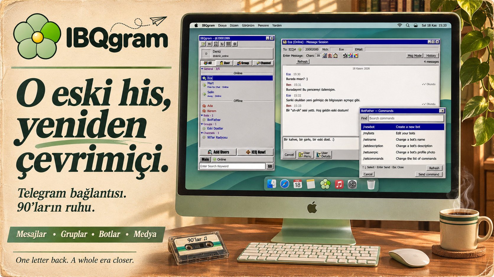

# IBQgram

**One letter back. A whole era closer.**

[English](README.md) · [Türkçe](README.tr.md)



A nostalgic desktop messenger built on **Telegram Desktop**. Classic grey windows, navy title bars, a flower in the menu bar, and your Telegram conversations behind them.

IBQgram is an independent, modified Telegram Desktop client. It is not affiliated with or endorsed by Telegram or ICQ.

## First public version

**v0.1.0-alpha.1 — source preview.** The current development target is macOS on Apple Silicon. The native app has been built and exercised locally; this release does not include a signed/notarized installer. Windows and Linux are not validated targets yet.

The promotional image was generated with ImageGen using the current UI and fictional account/message samples. It is an illustration, not a pixel-exact application screenshot.

## What works

- Telegram sign-in using a phone number, verification code and the upstream two-step verification flow; saved sessions.
- Separate, resizable contact and chat windows; real message history, sending/receiving, drafts and read receipts.
- Online/offline people, bots, groups and channels; filters, user search, adding contacts and blocking users.
- Forum topic selection and a separate, searchable bot command palette.
- File transfers with progress and a separate photo/video/audio viewer.
- Native macOS notifications with chat routing and configurable privacy/sound options.
- Light/dark themes, a monochrome macOS menu-bar icon and animated IBQgram branding.
- Nostalgic local statuses; optional status sharing through a visible Telegram name suffix, with explicit opt-in.
- A local, static ICQ Now! museum page.

**Current limits:** QR login, new-account registration and additional email setup flows are not implemented. Authentication edge cases, reconnect behavior and security properties still need broader independent testing. The public source does not include the locally supplied original sound recordings. Channel sponsored-message support and other Telegram API requirements require a release review before a general end-user launch. See [development](docs/DEVELOPMENT.md), [security](docs/SECURITY.md) and [licensing](docs/LICENSING.md).

## Try the shared UI

Requires **Node.js 20 or later**. No npm package installation is needed.

```sh
git clone https://github.com/badursun/ibqgram.git
cd ibqgram
npm run dev
```

Open `http://127.0.0.1:1999`. The browser view is a disconnected UI preview; Telegram account operations require the native client. `http://127.0.0.1:1999/?screen=contacts` shows fictional contacts for UI inspection.

## Build the native app

Requires macOS, Xcode and its command-line tools, Python 3, Node.js, Homebrew build tools and librsvg. The initial native dependency build is substantial; read the [complete build instructions](docs/DEVELOPMENT.md) first.

```sh
npm run source:prepare
cp .env.example .env
# Edit .env locally with your own Telegram API ID and hash.
# Prepare native dependencies as described in docs/DEVELOPMENT.md.
npm run native:configure
npm run native:build
npm run desktop:open
```

Get your own application credentials from [Telegram API development tools](https://my.telegram.org/apps). Never commit `.env`, session data, signing keys or build caches. Embedded application credentials can be extracted from binaries; they are not a substitute for protecting user session keys.

The app currently remains at `desktop/tdesktop/out/Debug/icqram.app`. Legacy internal names are preserved for storage compatibility; the visible product name is **IBQgram**. **Never run an Xcode clean against an existing development output containing an account.**

## Source layout and verification

This is a clean first public repository, not an export of private development history. It has no dependency on a private GitHub repository.

- `prototype/` — the shared HTML/CSS/JavaScript product interface.
- `desktop/patches/` — all IBQgram changes to the pinned public Desktop and WebView sources, including the native account/chat integration.
- `docs/upstream.json` — exact upstream revisions and patch paths. `source:prepare` reconstructs the modified sources locally.
- `desktop/Preview.swift` — optional WebKit UI preview shell, not the Telegram client.
- `branding/ibqgram/current/` — the current editable SVG identity only.
- `marketing/` — the current promotional image.

```sh
npm run source:prepare -- --minimal
npm run check
npm test
```

The minimal source preparation is sufficient for source tests, not native compilation. After building both preview and native bundles, `npm run ui:verify -- --native` compares packaged resources. `npm run security:verify` produces bounded local checks; it is not an independent security certification. [Initial source audit](docs/SOURCE-AUDIT.md).

## License and credits

New project code is **GPL-3.0-only**. Telegram Desktop's copyright notices, GPLv3/OpenSSL exception and dependency licenses are preserved in the reconstructed sources; copies of upstream notices are under `desktop/upstream/`.

The code license does not grant rights to third-party names, logos, historical artwork or recordings. Runtime retro assets have separate provenance/rights considerations; see [licensing and asset notes](docs/LICENSING.md). No trademark clearance is claimed.

Built with gratitude to [Telegram Desktop](https://github.com/telegramdesktop/tdesktop) and [desktop-app/lib_webview](https://github.com/desktop-app/lib_webview).
