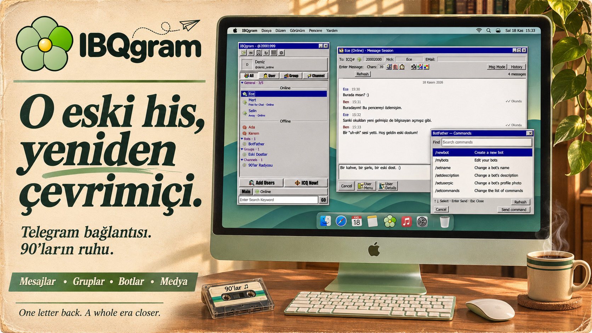

# IBQgram

**One letter back. A whole era closer.**

[English](README.md) · [Türkçe](README.tr.md)



**O eski his, yeniden çevrimiçi.** Telegram Desktop üzerine kurulu, klasik gri pencereleri, lacivert başlık çubuklarını ve menü çubuğundaki çiçeği bugünün Telegram sohbetleriyle buluşturan bağımsız masaüstü istemcisi.

IBQgram, Telegram Desktop'ın değiştirilmiş bir sürümüdür. Telegram veya ICQ ile bağlantılı ya da bu kuruluşlar tarafından onaylanmış resmî bir uygulama değildir.

## İlk herkese açık sürüm

**v0.1.0-alpha.1 — kaynak kod önizlemesi.** Mevcut geliştirme hedefi Apple Silicon işlemcili macOS'tur. Native uygulama yerelde derlendi ve kullanılarak kontrol edildi; bu sürüm imzalı/noter onaylı bir kurulum paketi içermez. Windows ve Linux henüz doğrulanmış hedefler değildir.

Tanıtım görseli, güncel arayüz ve kurgu hesap/mesaj örnekleri referans alınarak ImageGen ile üretildi. Birebir ekran görüntüsü değil, tanıtım illüstrasyonudur.

## Neler var?

- Telefon numarası, doğrulama kodu ve upstream iki aşamalı doğrulama akışıyla Telegram girişi; kayıtlı oturumlar.
- Ayrı ve boyutlandırılabilir kişi/sohbet pencereleri; gerçek geçmiş, mesaj gönderme/alma, taslaklar ve okundu bilgisi.
- Online/offline kişiler, botlar, gruplar ve kanallar; filtreler, kişi arama/ekleme ve engelleme.
- Forum konu seçimi ve ayrı, aranabilir bot komut paleti.
- İlerleme göstergeli dosya aktarımı ve ayrı fotoğraf/video/ses görüntüleyici.
- İlgili sohbeti açan macOS bildirimleri; gizlilik ve ses ayarları.
- Açık/koyu tema, temaya uyumlu tek renkli menü çubuğu simgesi ve animasyonlu IBQgram kimliği.
- Nostaljik yerel durumlar; açık onayla Telegram adının sonuna görünür bir etiket ekleyerek isteğe bağlı durum paylaşımı.
- Yerel, statik ICQ Now! müze sayfası.

**Mevcut sınırlar:** Retro arayüz upstream istemcinin yalnız bir bölümünü kullanıma sunuyor. Mesaj yanıtlama/düzenleme/silme/iletme/arama, bot klavyeleri, zengin mesaj çizimi, fotoğraf/video olarak gönderme ve bazı hesap/grup işlemleri henüz bağlı değil. QR girişi, yeni hesap oluşturma ve ek e-posta kurulumu da tamamlanmadı. Eski geçmişin güncellenmesi, yeniden başlatma sonrası belirsiz gönderimler, pencere kaynak sınırları, yeniden bağlanma ve güvenlik sınırları geliştirme veya doğrulama gerektiriyor. Arayüzde İngilizce/Türkçe karışımı sürüyor. Orijinal ses kayıtları, imzalı kurulum paketi ve IBQgram güncelleme mekanizması bulunmuyor. Genel kullanıcı dağıtımı öncesinde sponsorlu içerik ve diğer Telegram API gereklilikleri tamamlanmalı/değerlendirilmeli.

Kesin eksikleri, kısmi özellikleri, doğrulama işlerini ve isteğe bağlı sonraki kapsamı [önceliklendirilmiş tam yapılacaklar listesinde](TODO.md) bulabilirsiniz. Her maddede mevcut davranış ve tamamlanma ölçütü var. Ek bağlam: [geliştirme](docs/DEVELOPMENT.md), [güvenlik](docs/SECURITY.md), [lisans](docs/LICENSING.md). GitHub Actions kapalı kalıyor.

## Ortak arayüzü deneyin

**Node.js 20 veya üzeri** gerekir. npm paketi kurmanız gerekmez.

```sh
git clone https://github.com/badursun/ibqgram.git
cd ibqgram
npm run dev
```

`http://127.0.0.1:1999` adresini açın. Tarayıcı görünümü bağlantısız bir arayüz önizlemesidir; Telegram hesabı işlemleri native istemciyi gerektirir. `http://127.0.0.1:1999/?screen=contacts` adresi arayüz incelemesi için kurgu kişiler gösterir.

## Native uygulamayı derleyin

macOS, Xcode ve komut satırı araçları, Python 3, Node.js, Homebrew derleme araçları ve librsvg gerekir. İlk bağımlılık derlemesi kapsamlıdır; önce [tam kurulum talimatlarını](docs/DEVELOPMENT.md) okuyun.

```sh
npm run source:prepare
cp .env.example .env
# .env dosyasına kendi Telegram API ID ve hash değerlerinizi yerelde yazın.
# docs/DEVELOPMENT.md içindeki native bağımlılık hazırlığını tamamlayın.
npm run native:configure
npm run native:build
npm run desktop:open
```

Kendi uygulama bilgilerinizi [Telegram API geliştirme araçlarından](https://my.telegram.org/apps) alın. `.env`, oturum verileri, imzalama anahtarları ve derleme önbelleklerini Git'e eklemeyin. Uygulama API bilgileri derlenmiş dosyadan çıkarılabilir; kullanıcı oturum anahtarlarını korumanın yerine geçmez.

Paketin mevcut yolu `desktop/tdesktop/out/Debug/icqram.app` olarak korunur. Eski iç adlar depolama uyumluluğu içindir; görünen ürün adı **IBQgram**'dır. **Hesap içeren bir geliştirme çıktı klasöründe Xcode clean çalıştırmayın.**

## Kaynak yapısı ve kontroller

Bu depo temiz bir ilk yayındır; private geliştirme geçmişini taşımaz ve private GitHub depolarına bağımlı değildir.

- `prototype/` — ortak HTML/CSS/JavaScript ürün arayüzü.
- `desktop/patches/` — sabitlenmiş public Desktop ve WebView kaynaklarına yaptığımız bütün değişiklikler; native hesap/sohbet entegrasyonu dahil.
- `docs/upstream.json` — upstream sürümleri ve yama yolları. `source:prepare` değiştirilmiş kaynakları yerelde oluşturur.
- `desktop/Preview.swift` — yardımcı WebKit arayüz kabuğu; Telegram istemcisi değildir.
- `branding/ibqgram/current/` — yalnız güncel, düzenlenebilir SVG kimliği.
- `marketing/` — güncel tanıtım görseli.

```sh
npm run source:prepare -- --minimal
npm run check
npm test
```

Minimal hazırlık kaynak testleri içindir; native derleme için yeterli değildir. Her iki uygulama paketi derlendikten sonra `npm run ui:verify -- --native` paket dosyalarını karşılaştırır. `npm run security:verify` sınırlı yerel kontroller üretir; bağımsız güvenlik sertifikası değildir. [İlk yayın kaynak taraması](docs/SOURCE-AUDIT.md).

## Lisans ve teşekkür

Yeni proje kodu **GPL-3.0-only** kapsamındadır. Telegram Desktop telif bildirimleri, GPLv3/OpenSSL istisnası ve bağımlılık lisansları hazırlanan kaynaklarda korunur; upstream bildirimlerinin kopyaları `desktop/upstream/` altındadır.

Kod lisansı üçüncü taraf isim, logo, tarihî grafik veya kayıtları için hak vermez. Kullanılan retro varlıkların ayrı kaynak/hak değerlendirmeleri vardır: [lisans ve varlık notları](docs/LICENSING.md). Marka uygunluğu garantisi verilmez.

[Telegram Desktop](https://github.com/telegramdesktop/tdesktop) ve [desktop-app/lib_webview](https://github.com/desktop-app/lib_webview) geliştiricilerine teşekkürler.
